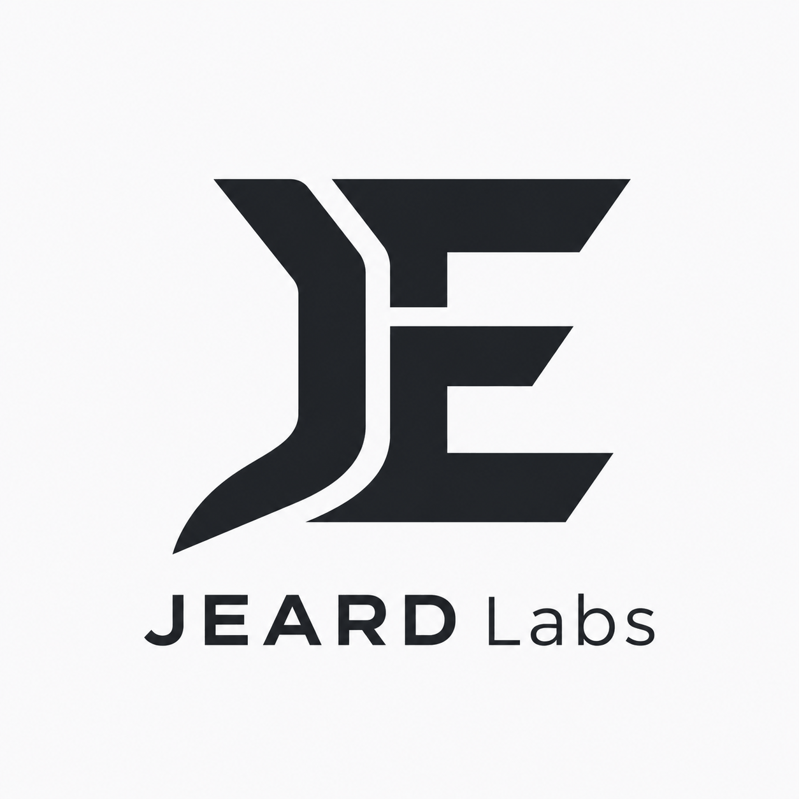

# JEARD Labs

**Intelligence, Engineered.**

[Website](https://jeardlabs.com/) · [Contact](mailto:contact@jeardlabs.com)

---

### What we do

JEARD Labs is a technology and engineering company building software, digital platforms and technical infrastructure. We work across application development, backend systems, data engineering and applied AI, with an emphasis on getting the fundamentals right: architecture, security, performance, testing and maintainability.

Our aim is straightforward: build technology that is useful, dependable and capable of growing beyond its first release.

### Engineering areas

- **Applications & platforms** - web and mobile products, APIs, integrations and backend services
- **Architecture & infrastructure** - databases, deployment, observability and scalable system design
- **Data & intelligence** - data pipelines, analytics, research tooling and practical AI/ML integrations
- **Digital health** - software workflows and platforms for healthcare delivery
- **Engineering research** - technical writing, experiments and lessons from building systems

### How we work

We favour clear requirements, deliberate technical choices and software that can be tested and maintained. That means paying attention to failure modes, privacy, operational reliability and the people who will use the system—not just how it looks in a demo.

### Technologies

   & More

### Projects & publications

We're developing products and engineering resources across our focus areas. Public repositories and technical publications will be linked here as they become available.

For an overview of the company and its work, visit **[jeardlabs.com](https://jeardlabs.com/)**.

---

  JEARD Labs · Intelligence, Engineered.

